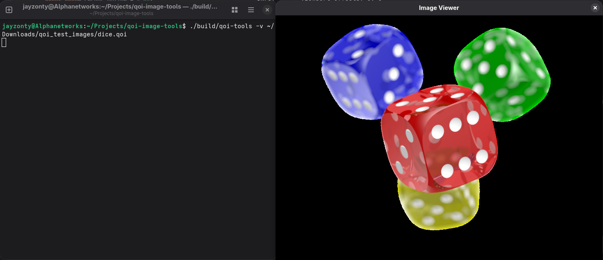

# QOI Image Tools
[英語版 (English)](./README.md)

## Overview
本プロジェクトは、ReducibleのYouTube動画[「How PNG Works: Compromising Speed for Quality」](https://www.youtube.com/watch?v=EFUYNoFRHQI)を参考し、QOI（.qoi）画像向けのツールセットを作成するための個人プロジェクトです。

現在、本プロジェクトには以下が含まれています：
- QOIデコーダー向けC++ヘッダーファイル [`qoi_decoder.hpp`](./qoi_decoder.hpp)
- QOIエンコーダー向けC++ヘッダーファイル [`qoi_encoder.hpp`](./qoi_encoder.hpp)
- 画像ファイルをQOI形式に変換するツール、および独自作成のビューアアプリでQOI画像を表示するための実行ファイルソースコード

## 使い方
### エンコーダー/デコーダー
qoi_decoder.hppまたはqoi_encoder.hpp（あるいはその両方）をダウンロードし、お使いのC++プロジェクトにインクルードしてご使用ください。
